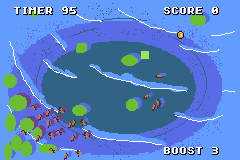

# Semantic Journey
In this game you will travel to many locations, 4 of them, and gather gold coins to afford the next adventure. Watch out, there is a time limit which will end your adventure and game over if it hits zero. Press start to reset your adventure, whether your win, lose, or want to get a better time!

## GitHub Page
https://crex424.github.io/collectathon/

## Disclaimer
This is a work-in-progress game used to aid our journey in learning how to develop GBA games using Butano, and programming systems in general. There are incomplete sections that still need polishing! Consider this an 'alpha' build.